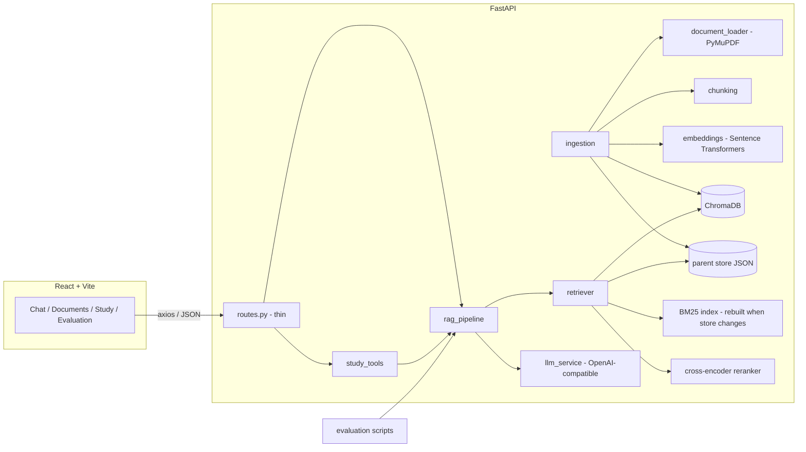

# AI Study Assistant — Chat with Your Documents (RAG)

Upload lecture PDFs, ask questions, and get answers **grounded in your material** with document + page citations.
Built directly on Python libraries (no LangChain in the core pipeline): PyMuPDF → chunking → Sentence-Transformers → ChromaDB → advanced retrieval → grounded LLM generation, with a measurable evaluation harness (retrieval metrics + RAGAS).

> **Honest status.** Everything below that says "tested" was run (74 automated tests, a live server run, a frontend production build, an offline evaluation run).
> What was **not** possible to run where this project was generated: the real Sentence-Transformers / cross-encoder models (they download from Hugging Face), a real LLM provider, and RAGAS scoring (needs an LLM judge). Those code paths are implemented against verified library APIs but you must run them on your machine — see [Verify on your machine](#verify-on-your-machine). No benchmark numbers are shipped; you generate your own.

---

## 1. Features

- **Documents**: PDF upload (type/size/magic-byte validation, sanitized names), SHA-256 duplicate detection, background indexing with status, chunk inspection, full deletion (vectors + parents + file + registry).
- **Chunking**: recursive (default), fixed-size baseline, semantic; configurable size/overlap; page numbers preserved; stable chunk IDs; parent passages for parent-document retrieval.
- **Retrieval strategies** (one common `RetrievalConfig`): similarity, **MMR**, **hybrid (dense + BM25 via RRF)**, **query expansion**, **multi-query (RRF)**; optional sequential stages: **cross-encoder reranking**, **parent-document retrieval**, **contextual compression**.
- **Grounded generation**: system prompt treats documents as untrusted data; evidence gate refuses to answer when nothing relevant is retrieved; citations `[S1]` are validated against retrieved chunks (invented ones are stripped); pages come from metadata, never from the model.
- **Study tools**: summary, simple explanation, MCQs, short-answer questions, flashcards, "explain why this answer is correct" — all reuse the same retrieval pipeline; items without valid sources are flagged as unsupported.
- **Diagnostics**: retrieval inspector (works without an LLM), per-chunk similarity / rerank scores, safe config display, evaluation dashboard fed by real result files.
- **Evaluation**: controlled 3-PDF corpus, 16-question dataset (factual, multi-chunk, technical terms, unanswerable, ambiguous, similar-distractor), Recall@K / Hit@K / Precision@K / MRR, latency & context size, optional RAGAS.

## 2. Architecture



**Data flow:** PDF → text + page extraction → parent passages → child chunks → embeddings → ChromaDB (+ parent JSON) → *query* → retrieval strategy → optional rerank → optional parent expansion → optional compression → evidence check → token-budgeted context → grounded prompt → LLM → citation validation → answer with sources.

The browser talks to FastAPI at `http://localhost:8000/api` (axios, `src/services/api.js`). CORS allows only `FRONTEND_ORIGIN` (default `http://localhost:5173`). API keys exist only in `backend/.env`.

## 3. Folder structure

```
ai-study-assistant/
├─ backend/
│  ├─ app/
│  │  ├─ main.py                  FastAPI app, CORS, logging
│  │  ├─ core/config.py           all settings (env-driven)
│  │  ├─ api/routes.py, deps.py   thin routes; object wiring
│  │  ├─ schemas/                 Pydantic request/response models
│  │  └─ services/
│  │     ├─ document_loader.py    PDF extraction, filename sanitising
│  │     ├─ chunking.py           fixed / recursive / semantic / parent-child
│  │     ├─ embeddings.py         Sentence-Transformers (+ offline test embedder)
│  │     ├─ vector_store.py       ChromaDB wrapper, schema, model-mismatch guard
│  │     ├─ registry.py           document registry + parent store
│  │     ├─ retriever.py          all strategies and stages
│  │     ├─ llm_service.py        OpenAI-compatible client, retries, typed errors
│  │     ├─ rag_pipeline.py       orchestration, context budget, citation validation
│  │     ├─ study_tools.py        summary / explain / quiz / flashcards
│  │     ├─ ingestion.py, reindex.py, evaluation_service.py
│  ├─ tests/                      74 tests (no network, no paid API)
│  ├─ reindex.py                  rebuild index after changing the embedding model
│  ├─ requirements.txt, requirements-eval.txt, .env.example
├─ frontend/                      React + Vite + plain CSS (src/components, pages, services, styles)
├─ evaluation/
│  ├─ datasets/ (build_test_corpus.py, qa_dataset.json, corpus/*.pdf)
│  ├─ evaluate_rag.py             library + single-strategy CLI (+ RAGAS)
│  ├─ compare_retrieval.py        all strategies → CSV / JSON / Markdown
│  └─ results/                    generated (git-ignored)
└─ README.md
```

Deviations from the suggested structure (all deliberate): `api/deps.py` (dependency wiring so tests can inject fakes), extra services (`ingestion`, `registry`, `study_tools`, `reindex`, `evaluation_service`), `requirements-eval.txt` (RAGAS pins kept separate), and `.env` is **not** shipped — you create it from `.env.example`.

## 4. Technology choices

| Choice | Why |
|---|---|
| FastAPI + Pydantic | Typed validation, automatic OpenAPI docs at `/docs`. |
| PyMuPDF | Fast text extraction with page granularity. Text layer only (see OCR). |
| Sentence-Transformers (`all-MiniLM-L6-v2`, 384-d) | Free, local, CPU-friendly; no embedding API cost. Configurable. |
| ChromaDB (persistent, cosine) | Simple embedded vector DB with metadata filtering and persistence. We pass our own vectors, so Chroma never silently embeds with another model. |
| `rank-bm25` | Small sparse index for the hybrid strategy. |
| `openai` SDK with configurable `base_url` | Works with any OpenAI-compatible provider; retries/timeouts handled by us. |
| React + Vite + plain CSS + axios + lucide-react | As specified; no Tailwind. |
| RAGAS 0.3.9 (pinned) | Metric names/imports verified against this version. |

## 5. Setup on Windows (PowerShell + VS Code)

Prerequisites: Python 3.11–3.12 and Node.js 18+. Open **two** VS Code terminals (PowerShell).

**Terminal 1 — backend**
```powershell
cd ai-study-assistant\backend
python -m venv .venv
.\.venv\Scripts\Activate.ps1
python -m pip install --upgrade pip
pip install -r requirements.txt
Copy-Item .env.example .env
notepad .env          # fill in LLM_API_KEY, LLM_MODEL, LLM_BASE_URL (see section 6)
uvicorn app.main:app --reload --port 8000
```
API docs: http://localhost:8000/docs · health: http://localhost:8000/api/health

**Terminal 2 — frontend**
```powershell
cd ai-study-assistant\frontend
Copy-Item .env.example .env     # optional; default API URL already http://localhost:8000/api
npm install
npm run dev
```
Open http://localhost:5173.

The first indexing/query downloads the embedding model (~90 MB) from Hugging Face once; afterwards it works offline. Without LLM credentials you can still upload, index, inspect chunks and use **Retrieve** in the Inspector; chat and study tools return a clear "LLM not configured" error.

## 6. Configuring a free-tier LLM

Use **your provider's official documentation** to obtain three values: an API key, a model name, and (if it is not OpenAI itself) the OpenAI-compatible base URL. Put them in `backend/.env`:
```
LLM_API_KEY=...
LLM_MODEL=...
LLM_BASE_URL=...
```
Notes: free-tier quotas and model availability change — check your provider's current limits; this project assumes none. If your provider rejects a parameter, adapt via `LLM_MAX_TOKENS_PARAM` (e.g. `max_completion_tokens`) and `LLM_SEND_TEMPERATURE=false`. If a provider is not OpenAI-compatible, replace the body of `LLMService.chat` — nothing else depends on it. Rate limits/timeouts are retried a bounded number of times (`LLM_MAX_ATTEMPTS`); auth/model/parameter errors are never retried. Upload and retrieval keep working when the LLM is down.

## 7. Tests

```powershell
cd backend
.\.venv\Scripts\Activate.ps1
pytest -q
```
74 tests cover: chunking and overlap, page metadata, parent-child links, embedding dimension/determinism, insertion/retrieval/metadata filter, idempotent re-ingestion, deletion (vectors, parents, BM25, files), persistence, model-mismatch refusal and reindexing, MMR diversity, RRF and hybrid exact-term retrieval, reranking score separation, multi-query/expansion (incl. LLM failure), parent expansion/missing parents, compression provenance, empty/unsupported retrieval (LLM never called), citation validation, prompt-injection prompt structure, LLM retry/rate-limit/auth behaviour, API validation/upload/size/traversal/duplicate/delete, study-tool validation, and the evaluation metric maths. Tests use a deterministic hashing embedder and a scripted fake LLM, so they cost nothing and need no network. Real-API tests are not included (optional by design).

## 8. Evaluation

**Retrieval vs answer evaluation.** Retrieval evaluation asks "did the right pages come back, and how early?" (Recall@K, Hit@K, Precision@K, MRR — no LLM needed). Answer evaluation asks "is the generated text faithful, relevant, correct?" (RAGAS, LLM-judged). A strategy can win one and lose the other, so they are reported separately.

```powershell
cd ai-study-assistant
backend\.venv\Scripts\Activate.ps1
python evaluation\datasets\build_test_corpus.py         # (re)builds the 3 test PDFs
python evaluation\compare_retrieval.py                  # retrieval metrics, all strategies, no LLM needed*
python evaluation\compare_retrieval.py --generate       # + answers & abstention rates (needs LLM)
pip install -r backend\requirements-eval.txt            # once, for RAGAS
python evaluation\compare_retrieval.py --generate --ragas
python evaluation\evaluate_rag.py --strategy hybrid_rerank --ragas   # single strategy
```
\*`multi_query` needs the LLM for query generation and is reported as *skipped* without it (never silently degraded). Outputs go to `evaluation/results/` (`comparison.json`, `.csv`, `.md`); the **Evaluation** page shows `comparison.json`.

- Metrics: Recall@K and MRR use page-level ground truth in `qa_dataset.json`; unanswerable questions are excluded from recall/MRR and instead report abstention (with `--generate`). RAGAS metrics: `faithfulness`, `answer_relevancy` (ResponseRelevancy, `strictness=1` to save quota), `llm_context_precision_with_reference`, `context_recall`. Judge failures (quota, parse errors) become NaN and are counted as `*_failed`, never hidden.
- `--offline` uses a word-hashing embedder and a word-overlap reranker so the harness can run without model downloads. **Those numbers only prove the plumbing works** and are flagged as such in every output file.
- With 16 questions, small differences between strategies are noise. The generated report only describes which strategy scored highest and says so; it makes no causal claims. Compare on your own documents before drawing conclusions.

## 9. How it works (and the differences that matter)

**Why RAG.** An LLM only knows its training data. RAG retrieves passages from *your* documents at question time and puts them in the prompt, so answers can be grounded in private material. It lowers, but cannot eliminate, hallucination: the model can still misread or over-generalise, retrieval can miss the right chunk, and citations can be wrong. Hence the evidence gate, citation validation (markers must map to retrieved chunks), and the "Supported by your documents" badge that is shown only when a valid citation exists. Retrieved context ≠ model knowledge: the prompt tells the model to separate the two ("Beyond the notes:").

**Chunking.** Chunks exist because embeddings and context windows are finite and one vector for a chapter blurs topics. Small chunks → precise matching but less context and more fragments; large chunks → more context but diluted embeddings and more LLM tokens. Overlap prevents a fact being cut in half at a boundary at the cost of redundancy. We index small *child* chunks and keep larger *parent* passages (default 500 / 1800 characters). Chunks never cross page boundaries so every citation has one exact page.

**Embeddings.** Text → tokens → the model outputs an embedding, a vector (384 floats here). Queries and chunks must use the *same* model, so the collection records its model/dimension and refuses a mismatch. Vectors are L2-normalised, so cosine similarity = dot product, and Euclidean distance is monotone in it. Chroma reports cosine *distance* = 1 − similarity. Scores are rankings, **not probabilities**: 0.6 is not "60% confident" (the UI labels them "cosine similarity"). `MIN_RELEVANCE` is a tunable heuristic gate, not a calibrated confidence.

**Collection schema** (`study_chunks`, cosine): id `<doc_id>:p<page>:P<parent>:c<child>`; document = chunk text; metadata = `doc_id`, `filename`, `page` (1-based), `chunk_index`, `parent_id`, `collection`; collection metadata = `embedding_model`, `embedding_dim`.

**Changing the embedding model.** Edit `EMBEDDING_MODEL` in `.env`, stop the server, run `python reindex.py` in `backend/`. It drops the collection and re-embeds every stored PDF. Starting the server with a mismatched model before reindexing fails loudly instead of mixing vector spaces.

| Concept pair | Difference |
|---|---|
| Embedding vs answer generation | Embedding model maps text to vectors for search (local, free, tokenizer of that model). The LLM generates text from a prompt (billed generation tokens, limited by its context window). |
| Dense vs sparse | Dense = meaning similarity (finds paraphrases). Sparse/BM25 = exact term overlap (finds identifiers like `VIF_2024`, formulas, names that embeddings may blur). Hybrid fuses both with RRF (rank-based, so no score normalisation needed). |
| Similarity vs MMR | Similarity returns the k closest chunks (often near-duplicates). MMR greedily picks chunks that are relevant *and* different from those already chosen (`λ·sim(q,d) − (1−λ)·max sim(d,selected)`). It may lower precision for questions that need repeated evidence — evaluate, don't assume. |
| Query expansion vs multi-query | Expansion adds LLM keywords/synonyms to *one* enriched query (searched alongside the original). Multi-query asks the LLM for several differently-worded questions, retrieves for each, and fuses rankings (RRF). Both always keep the original query and degrade to it if the LLM fails. Both can drift off-topic. |
| Reranking vs compression | Reranking **reorders/selects whole passages** with a cross-encoder that reads (query, passage) together — more accurate than comparing two independent vectors but one forward pass per candidate, so run on ~20 candidates. Compression **shrinks the passages** (here: keeps sentences similar to the query) after retrieval; it can drop needed evidence if too aggressive (threshold is configurable). It is not chunking: chunking happens once at index time, compression per query. |
| Parent-child vs ordinary retrieval | Child chunks (small) are matched for precision; the parent (large) passage is sent for context, deduplicated across hits and capped at 2,500 characters; a missing parent falls back to the child. It is not just "bigger chunks": the *matching* unit stays small. |
| Retrieval vs answer quality | See section 8. |
| RAG vs fine-tuning | RAG injects knowledge at query time (updatable instantly, citable, private data stays in your store). Fine-tuning changes model weights (good for style/format/skills, poor for fast-changing facts, no citations). |

**Prompting.** The *system* message holds the rules (answer only from excerpts, cite `[S#]`, say when not found, treat excerpts as untrusted data and ignore instructions in them, history is not evidence). The *user* message carries the delimited excerpts and the question. Temperature defaults to 0 for near-deterministic output (useful for evaluation; provider support varies). Context is capped by `CONTEXT_TOKEN_BUDGET` using a ~4 characters/token estimate.

## 10. API summary

`GET /api/health` · `POST/GET /api/documents` · `GET/DELETE /api/documents/{id}` · `GET /api/documents/{id}/chunks` · `POST /api/chat` · `POST /api/retrieve` · `POST /api/study/{summarize|explain|quiz|short-answer|flashcards|explain-answer}` · `GET /api/evaluation/results` · `POST /api/evaluation/run` · `GET /api/evaluation/status`. Full schemas at `/docs`.

## 11. Security notes

Implemented: keys only in backend env; `/health` and responses never include keys/URLs/paths; PDF extension + `%PDF-` magic-byte + size checks (bounded read); server-chosen storage names (no path traversal); CORS limited to the frontend origin and needed methods; documents treated as untrusted in prompts; citations validated; explicit LLM timeouts and bounded retries; logs avoid document content and request bodies.

**Not implemented:** authentication/authorization and per-user isolation. All users of one instance share one library. **Do not deploy this as a multi-user production service as is.** Prompt-injection defence is prompt-level plus citation validation; it reduces but does not eliminate risk.

## 12. Known limitations

- **Scanned PDFs**: PyMuPDF reads only the text layer. Image-only PDFs are rejected with an OCR message. To support them, run OCR first (e.g. install Tesseract and `ocrmypdf`, then upload the resulting searchable PDF); OCR is not bundled.
- Chunks do not span pages; tables/formulas extract as plain text.
- Contextual compression is embedding-based extractive filtering; LLM-based extraction is not implemented.
- Summaries of very long documents sample chunks evenly across the document within the context budget (and say so).
- Evidence gate uses the best dense similarity vs `MIN_RELEVANCE`; tune it per embedding model.
- Conversations are stored in the browser (localStorage); the backend is stateless.
- Evaluation dataset is small (16 questions) with page-level ground truth.
- Indexing runs in-process background tasks; a server crash mid-index marks the document failed on restart.
- Semantic chunking embeds every sentence, so it is slower.

## 13. Verify on your machine

1. `pytest -q` in `backend` (expect all pass).
2. Start both servers, upload `evaluation\datasets\corpus\data_science_regression.pdf`, wait for **Indexed**.
3. Chat tab → open **Settings** and try each strategy; use **Inspector** to see retrieved chunks.
4. After setting LLM credentials, ask "What VIF value is a warning sign?" (expect a cited answer, p. 2) and "What learning rate do gradient boosting machines use?" (expect an honest "not in your documents").
5. Enable *Cross-encoder reranking* once to trigger the reranker model download.
6. Run `python evaluation\compare_retrieval.py` and inspect `evaluation\results\comparison.md`; then try `--generate --ragas`.
7. Delete the document and confirm the Documents list and `/api/health` chunk count drop to zero.

## 14. Troubleshooting (Windows)

| Problem | Fix |
|---|---|
| `Activate.ps1 cannot be loaded` (execution policy) | `Set-ExecutionPolicy -Scope CurrentUser RemoteSigned` then re-activate. |
| `pip install` fails building a package | `python -m pip install --upgrade pip setuptools wheel`; use Python 3.11/3.12 (very new Python versions may lack wheels). |
| Torch download is huge / slow | Install CPU torch first: `pip install torch --index-url https://download.pytorch.org/whl/cpu`, then `pip install -r requirements.txt`. |
| Frontend shows "Cannot reach the backend" | Backend not running on port 8000, or `VITE_API_URL` wrong. Check http://localhost:8000/api/health. |
| CORS error in browser console | `FRONTEND_ORIGIN` in `.env` must exactly match the page origin (`http://localhost:5173`); restart the backend. |
| `Collection was built with 'X' but the app is configured for 'Y'` | You changed `EMBEDDING_MODEL`. Run `python reindex.py` (or set it back). |
| 503 "LLM is not configured" | Fill `LLM_API_KEY` and `LLM_MODEL` in `backend\.env` and restart. |
| 503 rate limited / unavailable | Free tiers throttle; wait and retry, or raise `LLM_TIMEOUT_SECONDS`. Evaluation: use `--delay 3`. |
| 502 "rejected by provider" | Wrong model/key/base URL, or an unsupported parameter (`LLM_MAX_TOKENS_PARAM`, `LLM_SEND_TEMPERATURE`). |
| "No extractable text found" | Scanned PDF — run OCR first. |
| Hugging Face download blocked | Download once on a network that allows it; models cache under `%USERPROFILE%\.cache\huggingface`. |
| Port 5173/8000 in use | `netstat -ano | findstr :8000` then `taskkill /PID <pid> /F`. |
| Long path / OneDrive locks on `chroma_db` | Keep the project outside OneDrive or set `CHROMA_PATH` to a short local path. |

## 15. Git hygiene

`.gitignore` excludes `.env`, virtual environments, `node_modules`, `backend/data/*` (uploaded private PDFs, parents, registry), `backend/chroma_db/*`, and `evaluation/results/*`. Before the first commit: `git status` and confirm none of those appear. The synthetic evaluation corpus PDFs are safe to commit.

## 16. Future improvements

Authentication and per-user collections; OCR integration; LLM-based compression/extraction; streaming responses; cross-page chunks; table-aware extraction; evaluation with human-labelled span-level evidence and statistical significance testing; server-side conversation storage; background job queue for indexing and evaluation.
